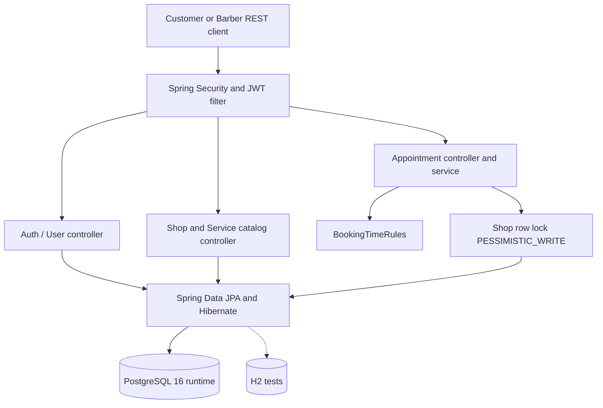

# Kufi — Week 7 integrated architecture

This describes the locally prepared code; it is not proof of a fresh clone or a PostgreSQL run. Update if your actual branch differs.

**Flow:** Client → signed JWT → appointment POST → service load → locked shop row → duration and hours checks → JPQL overlap check → insert or HTTP 409. The lock is per shop rather than per individual barber.

**Week 3 comparison:** Conceptual separate UI/security/controller/service/storage layers were consolidated into a modular Spring Boot monolith and one PostgreSQL datastore. The bundled source currently has a REST API but no implemented frontend, so do not claim a mobile interface or UI screenshot.
